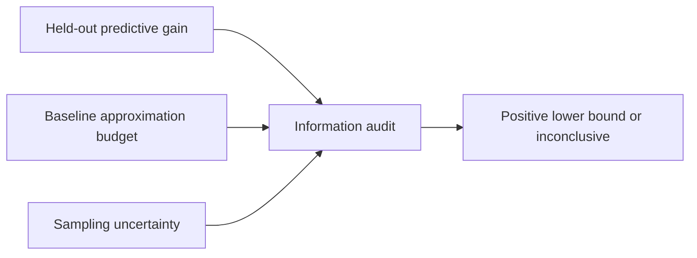

# What Does a Predictive Gain Certify?
### Auditing Information Claims under Approximate Inference

**An improved forecast can reflect a better use of existing inputs. When does a gain establish information from an added input?**

This work separates a fitted predictive improvement from an information claim. The audit accounts for baseline approximation error and statistical uncertainty; a positive gain alone is insufficient.

[Original experiments](foundation/code/experiments.py) · [Categorical shortcut](foundation/code/categorical_scalable.py) · [Saved records](foundation/results) · [Provenance](PROVENANCE.md)



## Three things to explore

1. **Why gain can mislead.** [`experiments.py`](foundation/code/experiments.py) constructs redundant-evidence examples with zero true new information and positive fitted gains, including an adverse approximate-inference example.
2. **A computational reduction.** [`categorical_scalable.py`](foundation/code/categorical_scalable.py) finds the least-probable class of a fixed known categorical baseline and solves one upper binary root. It checks the resulting forward/reverse KL quantities and scaling up to 100,000 classes.
3. **The audit decision.** The experiments compare a gain lower bound with an approximation-error witness before authorizing an information claim. [`multiclass_witness.py`](foundation/code/multiclass_witness.py) exposes the categorical witness calculations used by the shortcut checks.

## Run the recovered code

```bash
git clone https://github.com/cenacchi2000/Predictive-Gain-Audits.git
cd Predictive-Gain-Audits
python -m venv .venv
source .venv/bin/activate
pip install -r requirements.txt
export OPENBLAS_NUM_THREADS=1 OMP_NUM_THREADS=1
python foundation/code/experiments.py
python foundation/code/multiclass_witness.py
python foundation/code/categorical_scalable.py
```

Run in that order. The first command writes `foundation/results/experiments.json` and a diagnostic figure under `foundation/paper/`. The next commands regenerate categorical witness and numerical scaling records. Existing JSONs are retained research outputs and are overwritten by reruns. Runtime measurements will differ across machines.

## Code map

| File | Role |
|---|---|
| [`experiments.py`](foundation/code/experiments.py) | Binary KL envelope, empirical-Bernstein bound, separation examples, Monte Carlo checks |
| [`multiclass_witness.py`](foundation/code/multiclass_witness.py) | Multiclass witness calculations and checks |
| [`categorical_scalable.py`](foundation/code/categorical_scalable.py) | Least-mass categorical reduction and large-class scaling |
| [`foundation/results/`](foundation/results) | Corresponding saved JSON records |

## Possible use in surveillance research

Compare a hospitalisation-history baseline with a model that also receives wastewater data. A held-out improvement would establish a predictive gain for those pipelines. Concluding that wastewater adds information requires additional assumptions and control of baseline error. Rolling forecast origins, locations, reporting delays, and dependent observations need an adapted uncertainty analysis.

## Release scope

The Python files and corresponding saved records are **copied unchanged from the recovered 26 September 2026 research package**. This is a focused subset, not the complete manuscript artifact. It excludes natural-label Bayesian studies, spectral application replay, fitted models, and the full release's other experiments.

The exact categorical calculation assumes a fixed known baseline and a justified approximation budget. An arbitrary fitted forecasting baseline does not automatically satisfy those assumptions. Numerical checks use floating point; they are not formal proof certificates.

Related work: [Conditional score training](https://github.com/cenacchi2000/Training-Scores-for-Conditional-Audits) · [Counterfactual fragility](https://github.com/cenacchi2000/Counterfactual-Fragility-Certificates)
